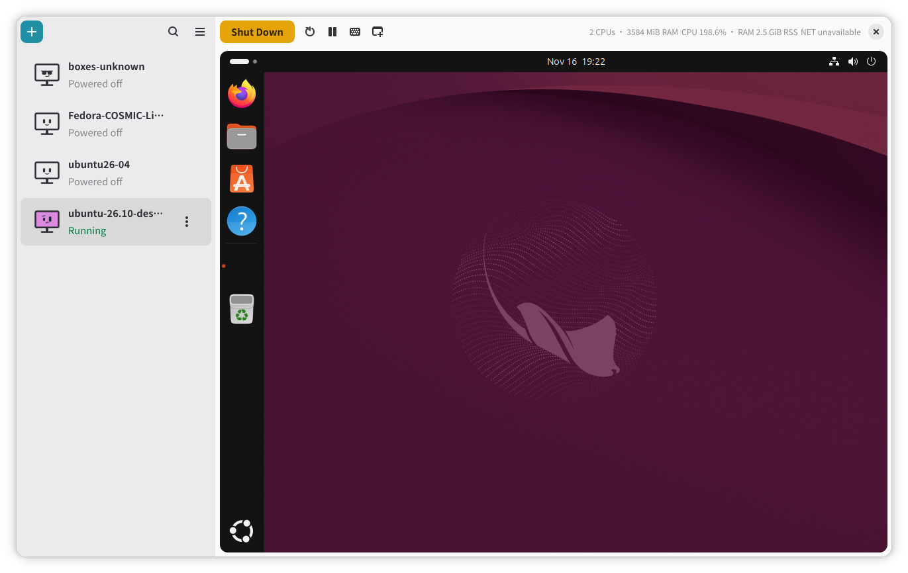

# Pirwa

A native GNOME virtual machine manager built around libvirt. Performance and
responsiveness come first. Inspired by GNOME Boxes, built with C17, GTK 4,
libadwaita, libvirt/libvirt-glib, SPICE GLib, libxml2, libosinfo, and Meson.

**Status: functional v0.1 development build.** A full Fedora installation,
ISO eject, and installed-disk boot passed in virtual GNOME. Release acceptance
remains open for the broader console/audio/accessibility matrix and the complete
performance contract. See the [installation evidence](docs/research/linux-install/README.md).
The [console/performance follow-up](docs/research/console-performance/README.md)
records resize, input, digital audio, reconnect, startup/idle measurements, and
the remaining storage measurement uncertainty. The [native console record](docs/research/native-console/README.md)
covers the GTK 4 replacement and its current limits.

## Features

- Persistent session/system connections, lifecycle events, bounded reconnect,
  search, stable VM identities, and virtualized rows.
- Native Boxes machines appear automatically in Session. An installed Boxes
  Flatpak gets a one-time import guide: copy a supported stopped VM into Session,
  including its disk and UEFI state, with progress/cancellation and the original kept.
  Existing VM definitions and disks stay in place. The Import header action
  reopens the guide later.
- Start, shutdown, restart, pause/resume, and confirmed force stop.
- Local bootable ISO creation and standalone qcow2 import, with progress,
  cancellation, allocation rollback, and source-image preservation.
- Experimental Windows 10/11 installation profiles with a separate VirtIO driver
  ISO and Windows 11 Secure Boot/TPM setup. See the [Windows guide](docs/user/windows.md)
  for prerequisites and the remaining installation validation.
- Capability-checked KVM/host CPU, virtio storage/networking, QXL video,
  UEFI or legacy BIOS, userspace networking, SPICE graphics/audio, and OS identification.
- Native GTK 4/libadwaita SPICE console with input release, fullscreen, resize,
  audio playback, and lifecycle reconnect. VNC and SPICE GL use an external virt-viewer fallback.
- Rename, CPU/RAM edits, and ISO eject while powered off.
- Confirmed removal; optional disk deletion requires an ownership record,
  matching domain/volume metadata, and checks for references from other VMs.
- Desktop/AppStream integration, gettext infrastructure, DEB/RPM/Flatpak recipes,
  headless tests, native desktop QA, sanitizer checks, and CI configuration.

## Build and run

Fedora development dependencies:

    sudo dnf install gcc git meson ninja-build python3 pkgconf-pkg-config gettext \
      glib2-devel gtk4-devel libadwaita-devel libvirt-devel libvirt-glib-devel \
      libxml2-devel libosinfo-devel spice-glib-devel libslirp-devel clang-tools-extra desktop-file-utils appstream

Runtime dependencies for real VMs include the distribution's QEMU/KVM libvirt
stack, osinfo-db, and spice-glib. Install virt-viewer for the VNC/SPICE GL fallback.
Windows 11 additionally needs `edk2-ovmf`, `swtpm`, and `swtpm-tools` on the host.
Configure the appropriate libvirt daemon
sockets for your distribution.

    sudo dnf install spice-glib libslirp virt-viewer qemu-kvm libvirt-daemon-driver-qemu \
      libvirt-daemon-driver-storage-core osinfo-db gsettings-desktop-schemas
    meson setup build
    meson compile -C build
    ./build/src/pirwa

The default is qemu:///session. Choose System explicitly in the header to see
system VMs. Run as your regular desktop user.

For subsequent development runs, rebuild and launch with:

    ./scripts/run-dev.sh

The launcher configures a missing build directory, works from any directory,
and forwards application arguments, such as `--version`. If rebuilding fails,
it reports the failure and dependency-recovery instructions. SPICE opens inside Pirwa. For the VNC/SPICE GL fallback, the launcher prefers an installed
virt-viewer and falls back to the local temporary dependency prefix when available.

For a safe synthetic demonstration without KVM:

    ./examples/run-test-driver.sh

The test driver supports controls and resource edits. QEMU provisioning and a
real graphical console require the real QEMU driver.

## Check

    meson test -C build --print-errorlogs
    clang-format --dry-run --Werror src/*.[ch] tests/*.c
    ./scripts/benchmark.sh

The default suite never changes real guests. An opt-in KVM test creates a
uniquely named disposable pool/VM, checks create/import/edit/rollback/removal,
and cleans its resources:

    PIRWA_RUN_KVM_TESTS=1 ./build/tests/test-kvm

It uses the Fedora UEFI shell ISO by default. Set PIRWA_TEST_ISO to another local
bootable x86 ISO if needed. It does not automate a full Linux installation.

On a desktop, exercise the actual window and test-driver controls:

    ./build/tests/test-ui --exercise
    ./build/tests/test-ui --exercise --large-text --dark --width 720

For an isolated virtual GNOME desktop with a 1280×800, 60 Hz monitor:

    ./scripts/test-gnome.py --output build/qa/gnome

This requires GNOME Shell with headless support and dbus-run-session. It runs
the light, large-text/dark, empty-collection, Boxes onboarding, console handoff,
and object lifetime cases, saves screenshots/logs,
and tears down its private compositor and settings directories.

The desktop tool also measures startup, idle CPU/PSS, and scrolling. See the
[performance workflow](docs/design/performance.md) for commands and measurement limits.

## Documents

- [User guide](docs/user/getting-started.md)
- [Architecture](docs/design/architecture.md)
- [v0.1 plan and remaining gates](docs/design/v0.1-plan.md)
- [Performance contract](docs/design/performance.md)
- [Implementation validation](docs/research/v0.1-validation.md)
- [v0.1.0 release readiness](docs/release/v0.1.0-readiness.md)
- [Building and publishing release packages](docs/release/publishing.md)
- [Console decision](docs/design/console-decision.md)
- [Setup and packaging](docs/implementation/setup.md)

The initial development host uses locally extracted development headers; see the
setup notes before making a fresh build there. Normal package installation is
recommended.

GPL-3.0-or-later. Pirwa is independent of GNOME Boxes. Its application ID is
`io.github.stonega.Pirwa`, under the repository owner's GitHub namespace.
The project repository is currently private; public project URLs and screenshot
assets must be reachable before public distribution. See the release checklist.
